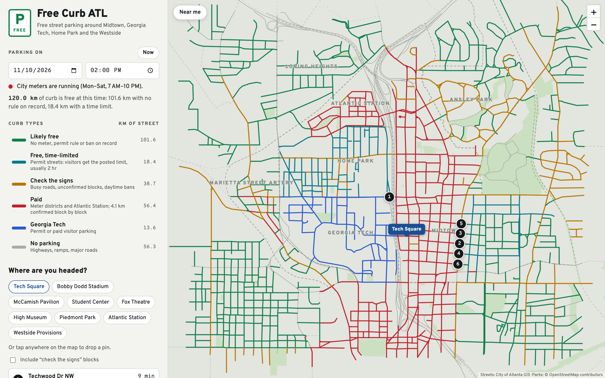
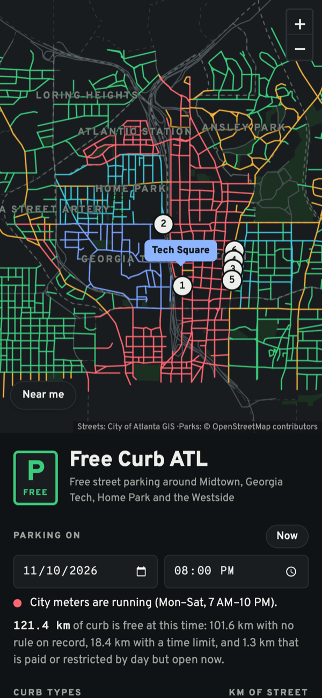
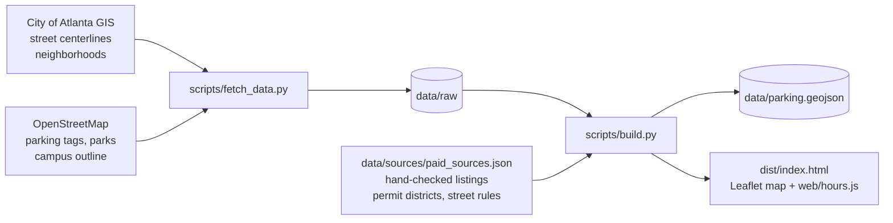

# Free Curb ATL

[](https://github.com/KCMake/atl-free-parking/actions/workflows/ci.yml)
[](LICENSE)

A map of free street parking around Midtown Atlanta, Georgia Tech, Home Park, Atlantic Station
and the Westside. Pick a day, a time and where you're headed, and it shows which curbs are free
right then and the closest ones, with walking times.



Atlanta doesn't publish where its parking meters are, so free parking can't be looked up; it has
to be inferred. The quick version, every street minus the paid ones, marks interstates, park
drives and permit-only streets as free. This project starts from the city's own street centerlines
and works through the evidence for each of 2,035 blocks: a hand-checked listing for that block if
there is one, then the district it's in, then the kind of road it is. Each block on the map says
which of those its color is based on.

## What it does

- **Colors 285 km of curb by rule:** likely free, free with a time limit, check the signs, paid,
  Georgia Tech, no parking.
- **Knows the meter clock.** City meters run Monday to Saturday, 7 AM to 10 PM, and are off on
  Sundays and nine city holidays. Blocks whose meters stop early, and blocks restricted only during
  the day, turn "free now" at the right hour. A weekday at 2 PM has 120 km of free curb; a Sunday
  has 171 km.
- **Finds parking near where you're going.** Pick Tech Square, Bobby Dodd, the Fox Theatre and
  others, tap anywhere on the map, or use your location. It lists the six closest free blocks,
  one per street, with walking minutes and a directions link.
- **Shows its work.** Every block's popup explains its color, links the source, and says whether
  the rule was confirmed for that block or inferred from its district.
- **Ships as one static HTML file:** no server, API keys or tracking. It works on phones and in
  light and dark mode.

<p align="center"></p>

## How it works



1. `scripts/fetch_data.py` downloads the city's street centerlines (with address ranges and road
   class) and neighborhood boundaries from its ArcGIS server, and parking tags, parks and the campus
   outline from OpenStreetMap.
2. `scripts/build.py` splits streets into blocks and gives each the first rule that applies.
   Exclusions come first, so no evidence can make a highway free. Block-level evidence comes next,
   then district-level inference. When the evidence is thin, a block is marked "check the signs"
   rather than free.

   | Order | Evidence | Result |
   |---|---|---|
   | 1 | Highway or ramp, a road with no curb lane (Northside Dr, Tech Pkwy), a drive inside a park, or an OpenStreetMap no-parking tag | No parking |
   | 2 | One of 63 on-street listings, each checked by hand; if several land on one block, the most restrictive wins | Its rule: paid, evening-only, time-limited, free |
   | 3 | An OpenStreetMap fee tag, Georgia Tech campus, Atlantic Station, or the Midtown and Downtown meter districts | Paid or campus |
   | 4 | Major arterial | No parking |
   | 5 | Named permit street, Home Park's permit program, another permit neighborhood, a busy minor road, or a listing whose rule isn't confirmed | Time-limited or check |
   | 6 | Same street as a confirmed meter within 150 m, or a side street inside the Midtown meter district | Check |
   | 7 | Anything else | Likely free |

3. The page (`web/template.html`) draws its own basemap from the same data, so it needs no tile
   server, and the map is rendered on a Leaflet canvas. `web/hours.js` holds the meter-hour rules
   as pure functions of Atlanta wall-clock time, so they can be tested apart from the page.

## Mistakes the data made, and how they're caught

- **Free parking on the interstate.** Subtracting paid streets from all streets leaves highways,
  ramps and park drives "free". These are excluded before any other rule runs, and a test checks
  that no such block is ever free.
- **Free blocks shown as paid.** Parkopedia files every on-street listing under a `/meter/` URL,
  free ones included. Reading the URL as evidence of a meter marked 8 blocks paid that are really
  free, time-limited or restricted only by day. Each listing's actual rule is now recorded, and a
  test pins 983–1051 Hemphill Ave as time-limited.
- **Silently missing streets.** The city's ArcGIS server truncated offset-paged results (993 of
  1,762 segments) without an error. The fetcher now pages by object id and fails if the counts
  don't match.
- **Addresses that didn't match.** Some city segments carry an address range on one side only, so
  a listing's address can fall just outside it. Listings now match the nearest range within 40
  house numbers; 62 of 63 match.

## How sure is it?

Of the 56.5 km marked paid, 4.1 km is confirmed block by block and 52.2 km is inferred from the
meter districts. The legend and every popup say which. The time-limited and evening-only blocks
come from neighborhood permit programs and individual listings.

## Run it

Needs Python 3.9+ (standard library only). `make data` also needs curl, and the JavaScript tests
need Node 18+.

```bash
git clone https://github.com/KCMake/atl-free-parking.git
cd atl-free-parking
make serve    # build, then open http://localhost:8000
```

```bash
make test     # Python and JavaScript tests
make lint     # ruff
make data     # re-download the raw inputs (the committed snapshot is enough to build)
```

## Tests

- `tests/test_classification.py` runs the real build on the committed data and pins past and
  possible mistakes: no free highways or park drives, Georgia Tech never free, the Parkopedia false
  positive, most-restrictive listing wins, Atlantic Station paid every day, every restricted block
  cites a source.
- `tests/test_sources.py` checks the hand-compiled `paid_sources.json`, so a new listing can't land
  malformed.
- `tests/hours.test.js` covers the meter clock: holidays (dates checked against Python's calendar),
  the 7 AM and 10 PM edges, per-block end hours, and daylight saving time.
- On every push, CI lints the code, rebuilds the map and checks that the committed
  `parking.geojson` matches a fresh build. It then runs both suites on Python 3.9 and 3.13.

## Add a block you've checked

Seen the signs on a block? Add it to `listings.items` in `data/sources/paid_sources.json`:

```json
{ "addr": "59 3rd St NW", "rule": "meter", "until": 19,
  "detail": "$3.50/hr, Mon–Sat 7 AM–7 PM, 2-hr max",
  "url": "https://en.parkopedia.com/parking/meter/59_3rd_street_nw/30308/atlanta/" }
```

`rule` is one of `meter`, `night` (restricted by day), `check`, `free_limit`, `free` or `unknown`;
`until` is the hour a meter stops, if earlier than 10 PM. Then run `make build test`.

## Project layout

```
scripts/fetch_data.py           download the raw inputs
scripts/build.py                classify every block, write the dataset and the page
data/sources/paid_sources.json  hand-compiled evidence: listings, districts, street rules
data/raw/                       fetched inputs, committed so builds are reproducible
data/parking.geojson            the output: one LineString per block, with status and reason
web/template.html               the page
web/hours.js                    meter-hour rules
tests/                          unittest and node:test suites
```

## Limitations

- Most "paid" streets are inferred from the meter districts. The city has no public meter
  inventory, and the ATLPlus zone map isn't machine-readable.
- Some Midtown permit-street sources date from 2011 and 2016, and the hours of Ansley Park's
  restricted streets aren't modeled.
- Game days, festivals, street cleaning, loading zones, hydrants, driveways and construction aren't
  modeled. **The signs on the block always win.**
- Walking time is straight-line distance × 1.3 at 80 m a minute, not a routed path.

## Sources

- Street centerlines and neighborhoods: [City of Atlanta GIS](https://gis.atlantaga.gov/)
- Parking tags, parks and the campus outline: © [OpenStreetMap](https://www.openstreetmap.org/copyright) contributors (ODbL)
- Meter hours and holidays: [ATLPlus parking zones](https://www.atlplusmobility.com/parking-zones)
- Permit streets: [Home Park](https://homepark.org/about/residential-permit-parking-program/),
  [Ansley Park](https://ansleypark.org/parkingpermit),
  [Midtown Alliance](https://midtownatlanta.org/enforcement-new-residential-permit-parking-programs-will-begin-may-16/),
  [City of Atlanta](https://www.atlantaga.gov/government/departments/transportation/strategy-and-planning/parking-services/residential-parking-permit)
- Block listings: Parkopedia, linked per block in `paid_sources.json` and in each popup

Not affiliated with the City of Atlanta, ATLPlus or Georgia Tech.

## License

Code: [MIT](LICENSE). The dataset includes OpenStreetMap data, available under the
[ODbL](https://opendatacommons.org/licenses/odbl/).
